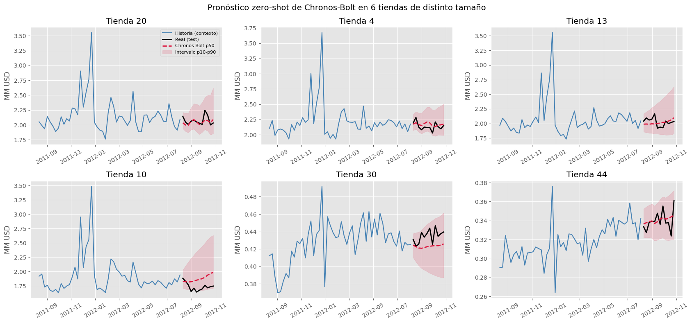
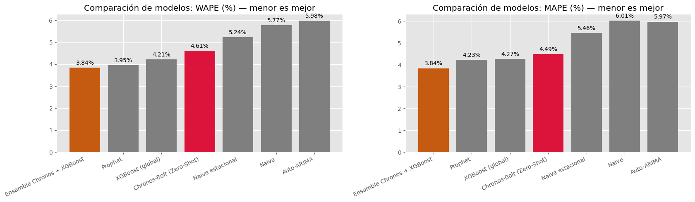
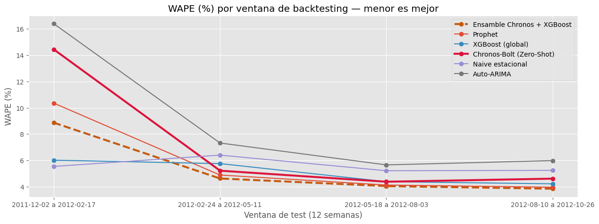

# Pronóstico de Demanda con Foundation Models: Chronos-Bolt vs. Modelos Clásicos

Pronóstico de ventas semanales de las **45 tiendas de Walmart** para las próximas 12 semanas con **Chronos-Bolt** (Amazon), un *Time Series Foundation Model* usado en modo **zero-shot**, sin entrenarlo con estos datos. Se compara contra Naive, Auto-ARIMA, Prophet y XGBoost.



## Problema
Con ARIMA o Prophet hay que ajustar **un modelo por tienda** (45 modelos) y reentrenarlos cada vez que llega data nueva. Un foundation model pronostica las 45 tiendas con **un solo modelo, en una sola llamada y en menos de 1 segundo**, y además entrega **intervalos de incertidumbre** (p10–p90) para el stock de seguridad.

## Datos
- **Fuente:** [Walmart Dataset – Kaggle](https://www.kaggle.com/datasets/yasserh/walmart-dataset)
- **Volumen:** 6,435 registros: 45 tiendas × 143 semanas (feb-2010 a oct-2012), sin nulos
- **Validación:** últimas 12 semanas como test, más *backtesting* con 4 ventanas (incluye Navidad 2011)

## Resultados (test ago–oct 2012, 45 tiendas)

| Modelo | WAPE | MAPE | Tiempo | ¿Entrena? |
|---|---:|---:|---:|---|
| **Ensamble Chronos + XGBoost** ✅ | **3.84 %** | **3.84 %** | 1.0 s | Solo XGBoost |
| Prophet | 3.95 % | 4.23 % | 9.5 s | 45 modelos |
| XGBoost (global) | 4.21 % | 4.27 % | 0.5 s | 1 modelo |
| **Chronos-Bolt (zero-shot)** | 4.61 % | 4.49 % | **0.5 s** | **No** |
| Naive estacional | 5.24 % | 5.46 % | — | No |
| Naive | 5.77 % | 6.01 % | — | No |
| Auto-ARIMA | 5.98 % | 5.97 % | 131.8 s | 45 modelos |

**Conclusiones clave**
- **Sin entrenamiento**, Chronos-Bolt supera a Auto-ARIMA y a los baselines, y pronostica las 45 tiendas en 0.5 s, frente a los 132 s de Auto-ARIMA.
- **Limitación:** con solo ~2 años de historia **no anticipa el pico navideño** (WAPE 14.4 % en dic-2011), porque es univariado y solo había visto un diciembre previo.
- El **ensamble Chronos + XGBoost** logra el menor error (**3.84 %**), es el mejor en 3 de 4 ventanas de backtesting y reduce el error navideño de Chronos de 14.4 % a 8.9 %.



## Metodología
1. **Ingesta y EDA con PySpark:** calidad de datos, agregaciones con Spark SQL, estacionalidad, descomposición STL, ACF y prueba ADF.
2. **Chronos-Bolt** (`amazon/chronos-bolt-small`, Hugging Face): Transformer encoder-decoder T5 de 47.7 M de parámetros. Incluye una exploración de su **tokenización por parches** dentro del modelo real.
3. **Modelos comparados:** Naive, Naive estacional, Auto-ARIMA, Prophet con feriados de EE.UU. y XGBoost global con lags ≥ 12 semanas.
4. **Evaluación:** MAE, RMSE, MAPE, WAPE y cobertura del intervalo p10–p90, más un **backtesting** con 4 ventanas *rolling origin*.
5. **Despliegue:** función de inferencia para un job semanal y un esqueleto de API con **FastAPI** ([`src/api_forecast.py`](src/api_forecast.py)).



## Herramientas
Python · PySpark · Pandas · PyTorch · Hugging Face (Chronos) · XGBoost · Prophet · pmdarima · Statsmodels · Scikit-learn · Matplotlib · Seaborn · FastAPI

## Estructura
```
├── notebooks/
│   └── walmart_forecasting_chronos.ipynb
├── src/
│   └── api_forecast.py          # API de pronóstico (FastAPI)
├── reports/
│   ├── figures/                 # gráficos del análisis
│   ├── model_comparison.csv
│   └── backtesting_wape.csv
└── requirements.txt
```

## Cómo ejecutarlo
1. Abre `notebooks/walmart_forecasting_chronos.ipynb` en **Google Colab**. Con GPU T4 es más rápido, pero también funciona en CPU.
2. El notebook instala las dependencias y descarga los datos automáticamente con `kagglehub`.
3. Para correrlo en local, instala las dependencias con `pip install -r requirements.txt`.


